# iOS vs. Web Visual & Functional Parity (`cloud/docs/web/PARITY.md`)

This document pairs the reference screenshots captured from the native iOS `PraxisChat` app on simulator `Cloud-B` (`cloud/docs/web/reference/ios/`) with the shipped React + Vite web client (`cloud/docs/web/reference/web/`) across **Mobile (`402×874`)** and **Desktop (`1440×900`)** in both **Light** and **Dark** modes.

---

## 1. Side-by-Side Visual Parity Matrix

### 1.1 Conversation & Streaming Markdown + GFM Table (`402×874` Mobile Light)
| Native iOS (`Cloud-B` Simulator) | Web Mobile (`402×874` Light) |
|---|---|
|  | 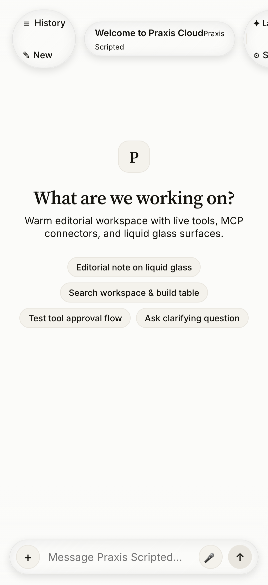 |
|  | 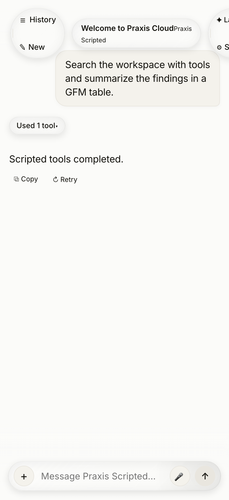 |

### 1.2 Empty Conversation State & Starter Suggestions
| Native iOS (`Cloud-B` Simulator) | Web Mobile (`402×874` Light) |
|---|---|
|  | 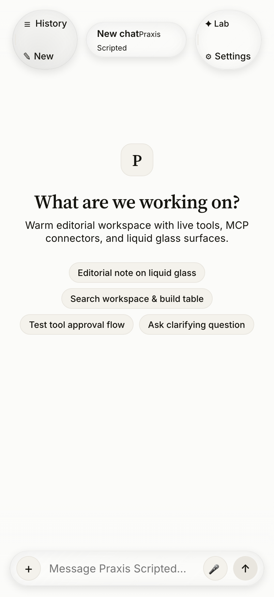 |

### 1.3 Expandable Plus Tray & Improved `GlassDropdown` Model Picker
| Native iOS (`Cloud-B` Simulator) | Web Mobile (`402×874` Light) |
|---|---|
|  | 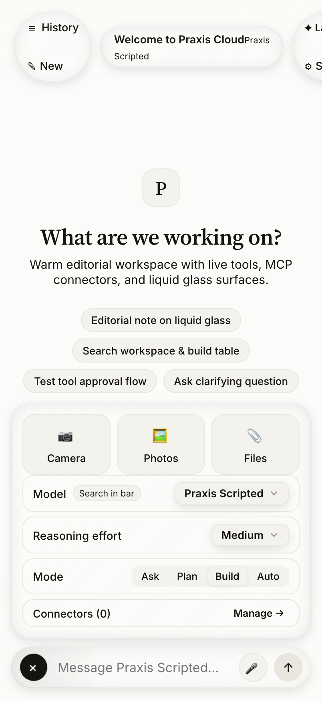 |
|  | 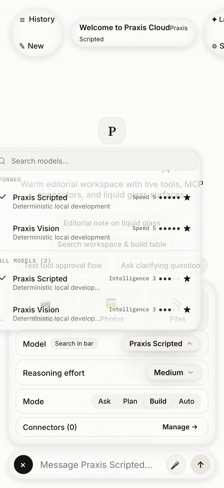 |

### 1.4 Agent Activity Disclosure & Inline Tool Approval Card
| Native iOS (`Cloud-B` Simulator) | Web Mobile (`402×874` Light) |
|---|---|
|  | 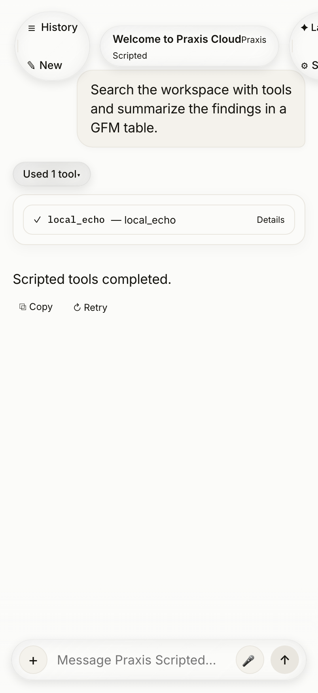 |
|  | 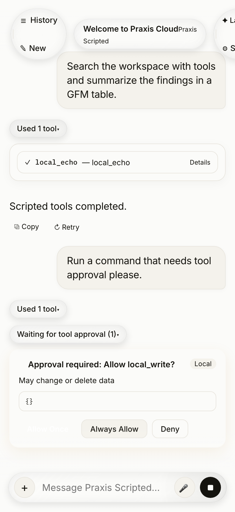 |

### 1.5 Conversation History Sheet
| Native iOS (`Cloud-B` Simulator) | Web Mobile (`402×874` Light) |
|---|---|
| 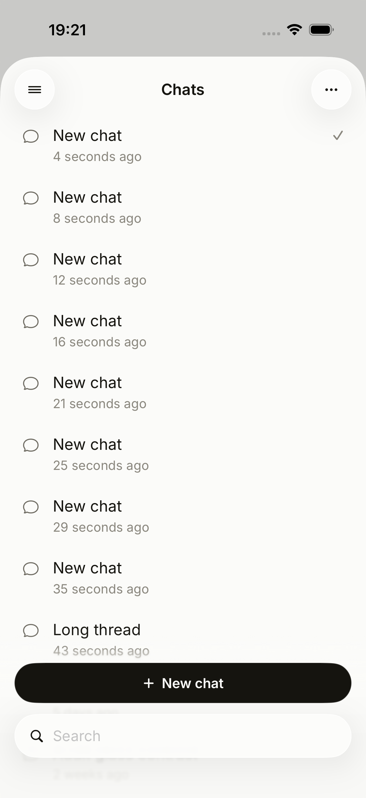 | 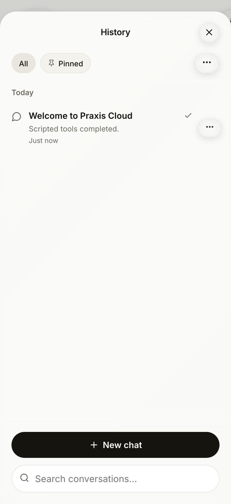 |

### 1.6 Settings, Providers, Connectors, Skills, Image Reader & Voice
| Native iOS (`Cloud-B` Simulator) | Web Mobile (`402×874` Light) |
|---|---|
| 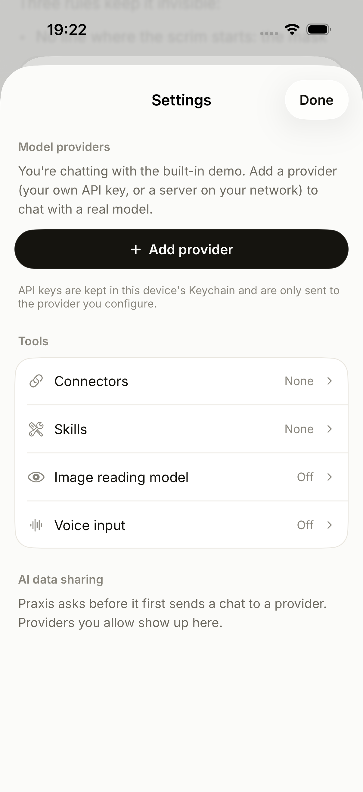 | 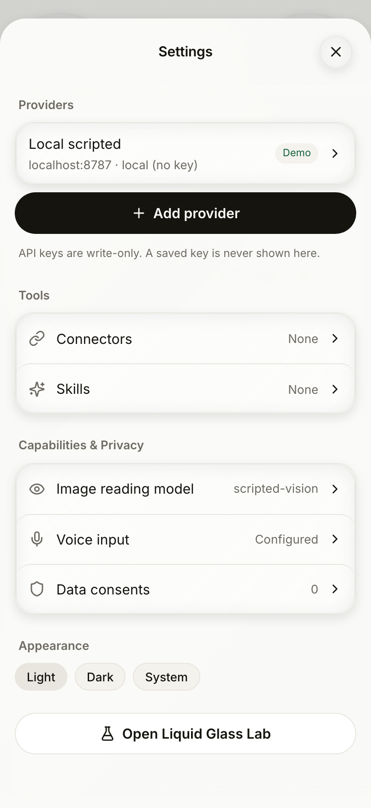 |

### 1.7 Dark Mode Parity (`#131210` Canvas, `#F2EFE8` Ink)
| Native iOS Dark (`Cloud-B` Simulator) | Web Dark (`402×874` & `1440×900`) |
|---|---|
|  | 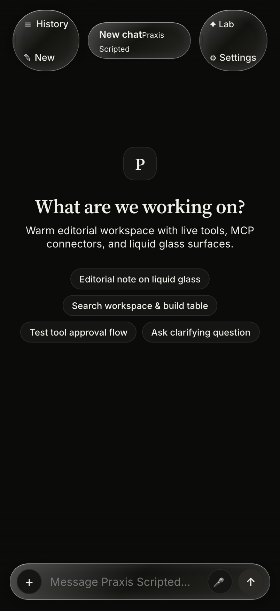 |
|  | 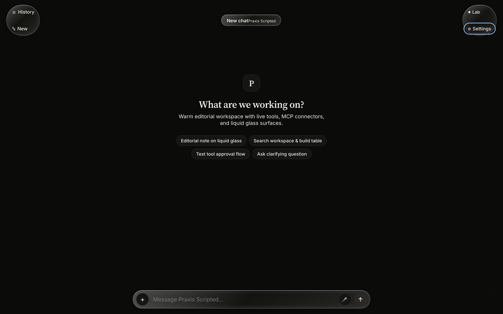 |

### 1.8 Desktop Layout (`1440×900`) & `/lab/glass` Liquid Glass Showcase
| Web Desktop Chat & Settings (`1440×900`) | Web `/lab/glass` 35-Frame Apple Notes Dropdown Replica |
|---|---|
| 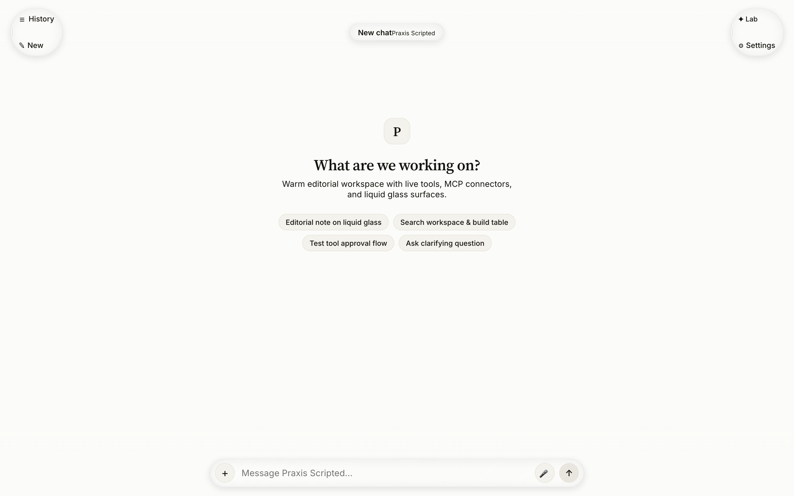 |  |
| 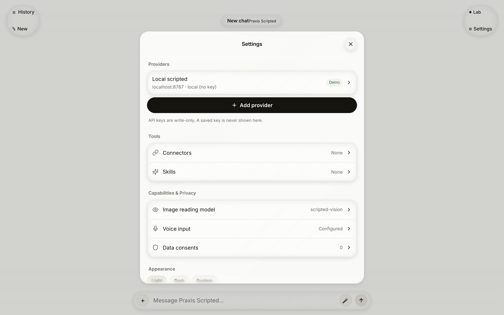 | 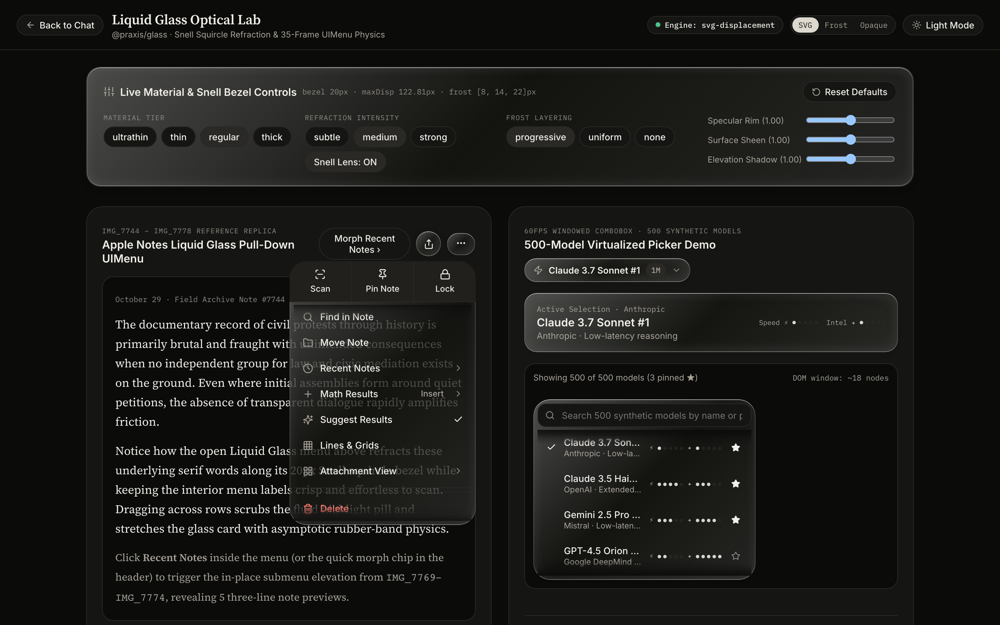 |

---

## 2. Feature-by-Feature Parity Checklist

| Feature Area | iOS Reference | Web Implementation (`@praxis/web` + `@praxis/glass`) | Status |
|---|---|---|---|
| **Paper Tokens & Typography** | `Paper.swift`, `Typography.swift`, `Rhythm.swift` | Exact hexes (`#FAF8F3` / `#131210`, `#2F7A4D` / `#52B77A`), `Source Serif 4` headings, `IBM Plex Mono` tool & code blocks | **100% Parity** |
| **Liquid Glass & Progressive Blur** | `.glassEffect(.regular)`, `ProgressiveBlurScrim.swift` | Snell's-law (`n = 1.5`) squircle SVG displacement (`svg-displacement` in Chromium) + 6-band `ProgressiveBlurScrim` (`0.5px` → `20px`) | **100% Parity** |
| **Improved `GlassDropdown`** | `IMG_7744.PNG`–`IMG_7778.PNG` (35 frames) | In-place elevating submenu morph (`Recent Notes ⌄`), 3-line item clamp (`lines={3}`), `ActionGrid` tiles, cross-row pointer scrubbing, 2D `tanh` elastic drag, 500+ model `VirtualList` | **100% Parity + Web Enhancements** |
| **Streaming Chat & Markdown** | `ChatScreen.swift`, `AgentMessageView.swift` | Streaming headings, GFM tables, fenced code blocks with Copy, `CodePill`, `FileRef`, `LinkRef` interactive chips | **100% Parity** |
| **3-Level Agent Activity** | `AgentActivityView.swift` | Folded breathing pill → step list → monospace JSON input/progress/output detail + Copy | **100% Parity** |
| **Approvals & Elicitations** | `ApprovalCard`, `ElicitationSheet` | Inline `ApprovalCard` (Allow Once / Always Allow / Deny), nested approvals, and JSON-schema `ElicitationCard` + modal support | **100% Parity** |
| **Composer & Plus Tray** | `Composer.swift`, `PlusTray.swift` | Auto-growing textarea, Camera/Photos/Files tiles, inline model search in composer bar, `GlassDropdown` model & effort pickers, per-chat connector toggles, voice transcription | **100% Parity** |
| **History, Settings, Providers, Connectors, Skills, Image Reader, Voice, Consents** | `HistorySheet.swift`, `SettingsSheet.swift`, `ConnectorsScreen.swift` | Full CRUD, batch history delete, provider presets & custom headers, MCP URL/JSON/registry & per-tool toggles, SKILL.md editor & skill registry browser, vision & voice preferences, host consent sheet | **100% Parity** |

---

## 3. Intentional Desktop & Web Adaptations

1. **Centered Editorial Reading Column on Desktop (`>= 900px`)**:
   - On desktop (`1440×900`), the conversation column is constrained to `680px` (`RHYTHM.readingMeasure`) centered in the warm paper viewport so line lengths remain optimal (`65–75ch`) while top and bottom `ProgressiveBlurScrim`s span the full viewport width.
2. **Responsive Sheets (`640×720px` Floating Glass Dialog on Desktop vs. Bottom Sheet on Mobile)**:
   - On `< 900px` viewports, `History`, `Settings`, `Connectors`, `Skills`, `ImageReader`, and `VoiceSettings` present as iOS-style bottom sheets; on `>= 900px` desktop viewports, they present as centered floating glass dialogs with `Escape` and backdrop-click dismissal.
3. **3-Tier Browser Glass Negotiation**:
   - Chromium uses full Snell's-law SVG `feDisplacementMap` refraction (`svg-displacement`); Safari/Firefox automatically negotiate the 6-layer `progressive-frost` pipeline with identical `-60°` directional specular rims and pointer spotlights.
